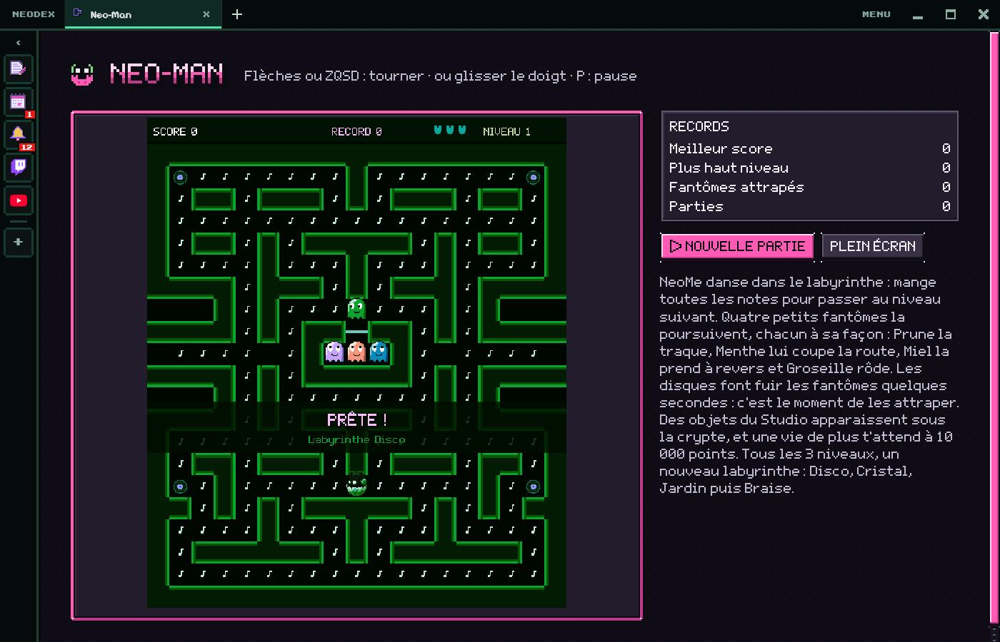

# Neo-Man

A pixel art maze game: NeoMe eats every music note while four little ghosts chase her.

*Version française : [README.md](README.md)*

## Controls

- **Arrows** or **WASD** (or **ZQSD**): turn. NeoMe takes the turn as soon as it opens, and can turn back at any time.
- **Finger or mouse**: swipe in the direction you want.
- **Space**: start, then play again. **P** or **Esc**: pause.

## How it works

- Eat **every note** to reach the next level. Each note plays a sound of the melody.
- Four little pixel art ghosts chase you, each in its own way:
  - **Prune** (purple) rushes straight at you;
  - **Menthe** (green) aims four tiles ahead of you to cut you off;
  - **Miel** (orange) catches you from behind, on the other side of Prune;
  - **Groseille** (red) comes close, then backs off when she gets too near.
- Now and then, the ghosts scatter to their corners before hunting again.
- The four **records** make the ghosts flee for a few seconds: they turn blue and you can catch them (200, 400, 800 then 1600 points). They go back to the crypt and come out again.
- Twice per level, a **Studio item** appears under the crypt: sword, clock, watch or lightning stone (100 to 1000 points).
- 3 lives, one more at **10,000 points**. Each level goes a bit faster, and the records last a bit less.

## Mazes

Every 3 levels, NeoMe changes maze: **Disco** (purple walls, levels 1 to 3), **Crystal** (ice blue, 4 to 6), **Garden** (green, 7 to 9) then **Embers** (orange, 10 to 12), and round again. The ghosts' crypt, the start and the bonus spot stay the same; the corridors, the side-to-side passages and the discs' places change. The new maze's name shows at the start.

## Full screen

The **Full screen** button fills the whole screen with the maze (Escape to leave). Otherwise it takes all the height the window leaves, from a small laptop to a big screen.

## Statistics

The Records panel keeps your **best score**, your **highest level**, the **ghosts caught** and the number of **games**.

## Data and sync

Your records are saved by NeoDex, backed up and synced between your PCs if sync is on.

## Install

In NeoDex: **NeoStore → Discover → Neo-Man → Install**.

Building a plugin: see the [NeoDex SDK](https://github.com/NDesumeur/neodex-sdk).
