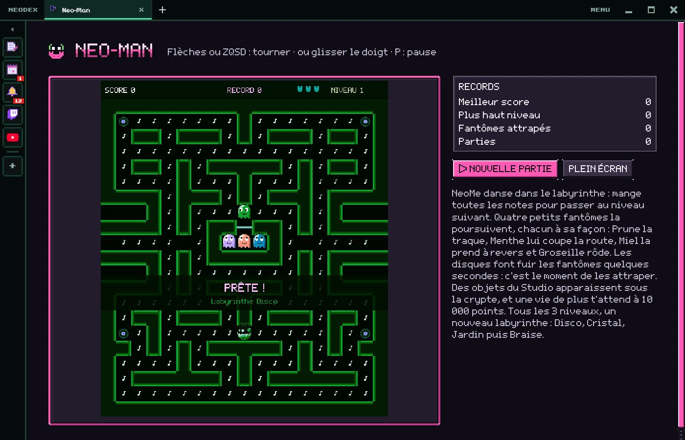

# Neo-Man

Un jeu de labyrinthe en pixel art : NeoMe mange toutes les notes de musique pendant que quatre petits fantômes la poursuivent.

*English version: [README.en.md](README.en.md)*

## Commandes

- **Flèches** ou **ZQSD** (ou **WASD**) : tourner. NeoMe prend le virage dès qu'il s'ouvre, et peut faire demi-tour à tout moment.
- **Doigt ou souris** : glisse dans la direction voulue.
- **Espace** : commencer, puis rejouer. **P** ou **Échap** : pause.

## Comment ça marche

- Mange **toutes les notes** pour passer au niveau suivant. Chaque note joue un son de la mélodie.
- Quatre petits fantômes en pixel art te poursuivent, chacun à sa façon :
  - **Prune** (violet) fonce droit sur toi ;
  - **Menthe** (vert) vise quatre cases devant toi pour te couper la route ;
  - **Miel** (orange) te prend à revers, de l'autre côté de Prune ;
  - **Groseille** (rouge) approche puis s'éloigne quand elle est trop près.
- De temps en temps, les fantômes se dispersent vers leurs coins avant de reprendre la chasse.
- Les quatre **disques** font fuir les fantômes quelques secondes : ils deviennent bleus et tu peux les attraper (200, 400, 800 puis 1600 points). Ils rentrent à la crypte et ressortent.
- Deux fois par niveau, un **objet du Studio** apparaît sous la crypte : épée, horloge, montre ou pierre de foudre (100 à 1000 points).
- 3 vies, une de plus à **10 000 points**. Chaque niveau va un peu plus vite, et les disques durent un peu moins longtemps.

## Les labyrinthes

Tous les 3 niveaux, NeoMe change de labyrinthe : **Disco** (murs violets, niveaux 1 à 3), **Cristal** (bleu glacier, 4 à 6), **Jardin** (vert, 7 à 9) puis **Braise** (orange, 10 à 12), et on recommence. La crypte des fantômes, le départ et la place des bonus restent les mêmes ; les couloirs, les passages d'un bord à l'autre et la place des disques changent. Le nom du nouveau labyrinthe s'affiche au départ.

## Plein écran

Le bouton **Plein écran** agrandit le labyrinthe à tout l'écran (Échap pour en sortir). Hors plein écran, il prend toute la hauteur que laisse la fenêtre, du petit portable au grand écran.

## Statistiques

Le panneau Records garde ton **meilleur score**, ton **plus haut niveau**, les **fantômes attrapés** et le nombre de **parties**.

## Données et synchronisation

Tes records sont enregistrés par NeoDex, sauvegardés et synchronisés entre tes PC si la synchro est activée.

## Installer

Dans NeoDex : **NeoStore → À découvrir → Neo-Man → Installer**.

Développer un plugin : voir le [SDK NeoDex](https://github.com/NDesumeur/neodex-sdk).
